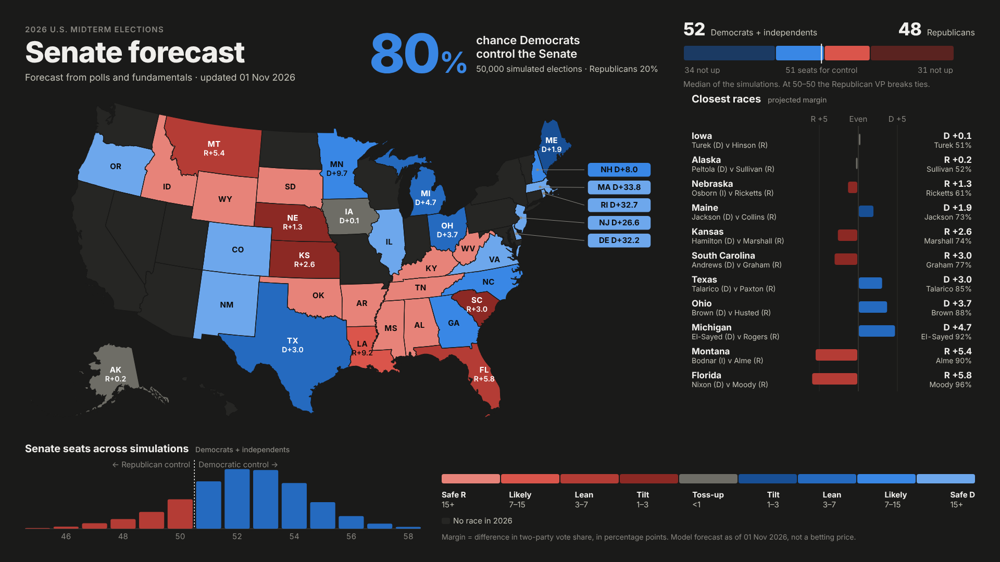
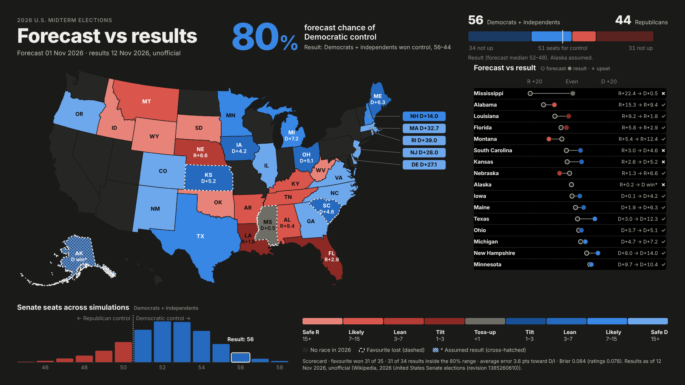
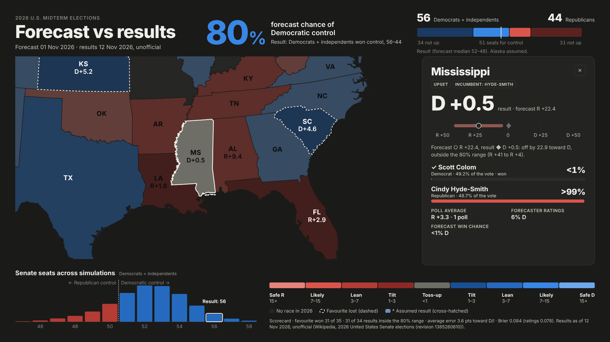
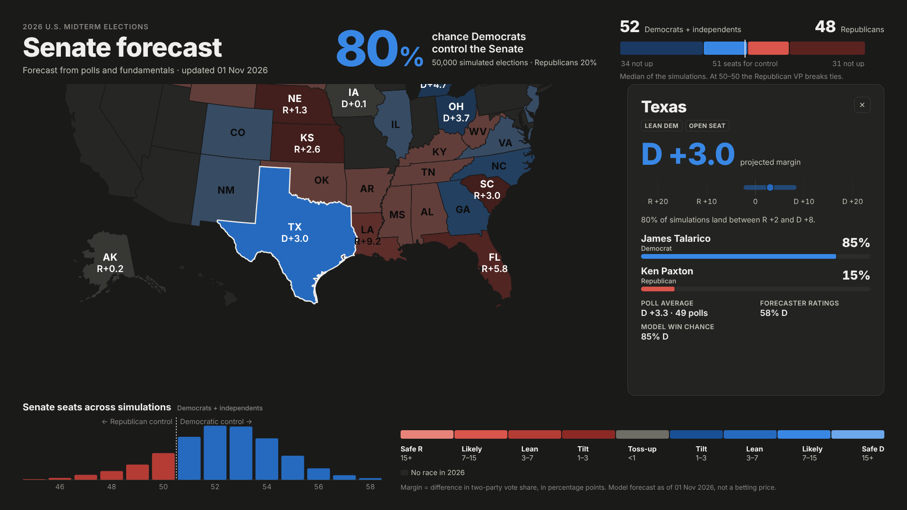
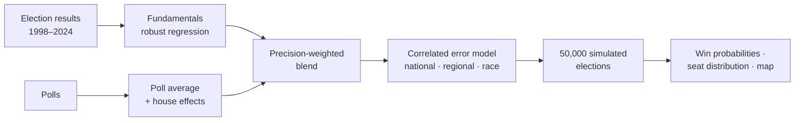
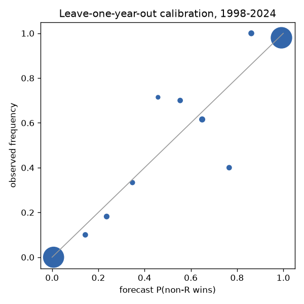
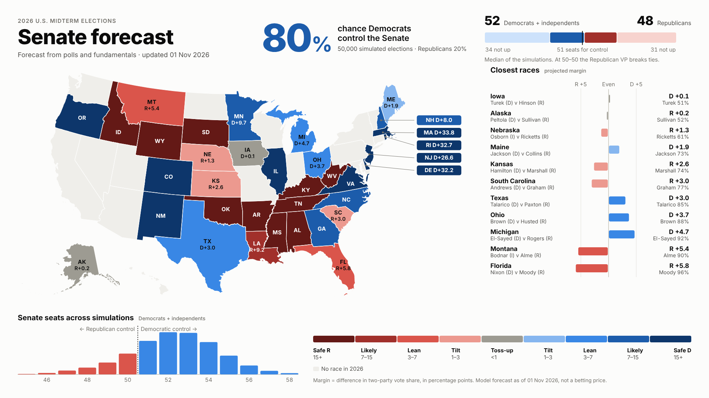

# 2026 U.S. Senate Forecast

A statistical forecast of every 2026 U.S. Senate race. It blends polls with fundamentals, simulates the
election 50,000 times with correlated errors, and is validated out of sample on 14 past elections
(1998–2024). An interactive map built for video presents the results.



## Results: how the forecast did

*Updated 12 November 2026 with unofficial results from
[Wikipedia](https://en.wikipedia.org/w/index.php?title=2026_United_States_Senate_elections&oldid=1385260610)
(revision 1385260610). Alaska's ranked-choice count is still pending; a Democratic win is assumed.*

**The big call was right, but the margins leaned one way.**
- **Control:** Democrats and independents won control 56–44, the outcome the forecast gave 80%.
- **Margins:** they beat their projected margin in 25 of 34 races, by +3.6 points on average.
- **Seats:** that pushed the seat count into the forecast's upper tail. 56 or more seats had a 6.3%
  chance. Without the Alaska assumption the count is 55, the top of the 80% range of 49–55.



| | 2026 | Backtest, 14 years (mean) |
|---|---|---|
| Winners called | 31 of 35 (88.6%) | 93.9% |
| Results inside their 80% range | 31 of 34 (91%) | 80.3% |
| Brier score (lower is better) | 0.084 (ratings consensus 0.078) | 0.041 |
| Log loss (lower is better) | 0.318 (ratings consensus 0.257) | 0.129 |
| Mean margin error | +3.6 points toward D/I | −1.2 |

**Upsets:** the forecast expected 2.8 and there were 4.

| State | Forecast | Chance it gave the winner | Result |
|---|---|---|---|
| Alaska | R +0.2 | 48% | Peltola wins (assumed) |
| Kansas | R +2.6 | 26% | D +5.2 |
| South Carolina | R +3.0 | 23% | D +4.6 |
| Mississippi | R +22.4 | 0.5% | D +0.5 |

**What the results say about the model:**
- **A shared miss, as the error model allows.** The average error of +3.6 points toward Democrats and
  independents is about 1.5 times the model's national error scale (σ = 2.5). Because that error is
  shared by every race in each simulation, 56 seats was in the distribution at all (6.3%), not
  impossible.
- **Mississippi is the lesson for races without usable polls.** Its one poll (R +3.3) fell below the
  recency-weight cut-off, so the forecast was pure fundamentals (R +22.4). Win probabilities also use a
  tighter error scale than the 80% ranges (see [Uncertainty](#5-uncertainty-correlated-fat-tailed-errors)).
  Together these made the model overconfident: 0.5%, where the forecaster ratings said 6%. Mississippi
  alone is 48% of the year's log loss. Without it the model scores 0.172, against 0.182 for the ratings.
  Louisiana and Alabama were also fundamentals-only. In Louisiana too the stale poll was closer to the
  result; in Alabama it was not.
- **The polls beat the blend this year.** In the 24 polled races the poll averages alone missed by
  6.2 points (RMSE). The blend missed by 7.3, and fundamentals alone by 10.5: the fundamentals leaned
  further toward Republicans than the result, and the blend inherited part of that lean. One year is
  not a reason to reweight; the backtest chose the weights over 14 elections.
- **Independents fell short.** Three of the four independent candidates did worse than projected
  (Montana −7.0, Nebraska −5.4, South Dakota −4.1); Idaho did better (+7.8).

**Next:**
- add 2026 to the training data and re-run the backtest;
- widen the race-level error in win probabilities where no polls are usable;
- re-score when Alaska is final.

**More:** the race-by-race table and every score are in
[`reports/scorecard_2026.md`](reports/scorecard_2026.md). In the map, press **V** or open `?results`.



## The forecast

*Model run of 1 November 2026, using polls downloaded on 31 October. This is the forecast as published
before the election; see [Results](#results-how-the-forecast-did) for how it did.*

**Democrats and independents win control of the Senate in 80% of 50,000 simulated elections.**
Republicans keep control in 20%.

- **Seats:** the median outcome is **52–48** for Democrats + independents. 80% of simulations land
  between 49 and 55 seats.
- **Ties:** a 50–50 Senate happens in 9% of simulations. The Republican vice president would then
  break ties, so 51 seats are needed for control.
- **Seats not up:** 34 Democratic or independent and 31 Republican seats are not up in 2026.
- **What's on the ballot:** 35 races, including specials in Ohio and Florida. 21 of them are projected
  by 10 points or more (11 Democratic, 10 Republican), which leaves 14 races deciding the majority.

### The competitive races

| State | Candidates (non-R v R) | Projected margin | 80% range | Win probability | Rating |
|---|---|---|---|---|---|
| Iowa | Josh Turek (D) v Ashley Hinson (R) | D +0.1 | R +6 to D +7 | Turek 51% | Toss-up |
| Alaska | Mary Peltola (D) v Dan S. Sullivan (R) | R +0.2 | R +12 to D +12 | Sullivan 52% | Toss-up |
| Nebraska | Dan Osborn (I) v Pete Ricketts (R) | R +1.3 | R +14 to I +12 | Ricketts 61% | Tilt Rep |
| Maine | Troy Jackson (D) v Susan Collins (R) | D +1.9 | R +5 to D +9 | Jackson 73% | Tilt Dem |
| Kansas | Adam Hamilton (D) v Roger Marshall (R) | R +2.6 | R +12 to D +7 | Marshall 74% | Tilt Rep |
| South Carolina | Annie Andrews (D) v Darline Graham (R) | R +3.0 | R +13 to D +7 | Graham 77% | Tilt Rep |
| Texas | James Talarico (D) v Ken Paxton (R) | D +3.0 | R +2 to D +8 | Talarico 85% | Lean Dem |
| Ohio (special) | Sherrod Brown (D) v Jon Husted (R) | D +3.7 | R +3 to D +10 | Brown 88% | Lean Dem |
| Michigan | Abdul El-Sayed (D) v Mike Rogers (R) | D +4.7 | R +2 to D +12 | El-Sayed 92% | Lean Dem |
| Montana | Seth Bodnar (I) v Kurt Alme (R) | R +5.4 | R +15 to I +5 | Alme 90% | Lean Rep |
| Florida (special) | Angie Nixon (D) v Ashley Moody (R) | R +5.8 | R +12 to D +1 | Moody 96% | Lean Rep |
| New Hampshire | Chris Pappas (D) v John E. Sununu (R) | D +8.0 | D +1 to D +15 | Pappas 98% | Likely Dem |
| Louisiana | Jamie Davis (D) v Julia Letlow (R) | R +9.2 | R +28 to D +10 | Letlow 91% | Likely Rep |
| Minnesota | Peggy Flanagan (D) v Michele Tafoya (R) | D +9.7 | D +1 to D +18 | Flanagan 99% | Likely Dem |

- **Margin** is the difference in two-party vote share, in percentage points. "D +3.0" means a 51.5–48.5
  split. Independents (Nebraska, Montana) are on the non-Republican side.
- **Ratings** follow the margin:

  | Rating | Margin (points) |
  |---|---|
  | Toss-up | < 1 |
  | Tilt | 1–3 |
  | Lean | 3–7 |
  | Likely | 7–15 |
  | Safe | 15+ |

- **Why the ranges look wider than the probabilities suggest:** the 80% ranges and the win
  probabilities are calibrated separately (see [Uncertainty](#5-uncertainty-correlated-fat-tailed-errors)).
- **All 35 races** are in [`reports/forecast_2026.md`](reports/forecast_2026.md) and in the map's
  table view.

Click any state on the map for its card:



## How the model works



Model 1 never sees betting-market prices. Every parameter that is estimated from data is re-estimated
inside each validation fold, so no test year leaks into its own forecast.

### 1. Data

| Source | Used for |
|---|---|
| [MIT Election Data and Science Lab](https://electionlab.mit.edu/), U.S. Senate returns 1976–2024 ([doi:10.7910/DVN/PEJ5QU](https://doi.org/10.7910/DVN/PEJ5QU)) and presidential returns by state ([doi:10.7910/DVN/42MVDX](https://doi.org/10.7910/DVN/42MVDX)) | Training targets; each state's partisan lean |
| FiveThirtyEight poll archives ([fivethirtyeight/data](https://github.com/fivethirtyeight/data), 2024 files via the Wayback Machine) | Historical Senate and generic-ballot polls with their outcomes |
| [electoral-vote.com](https://www.electoral-vote.com/) 2026 Senate polls | 2026 polls |
| Wikipedia's [2026 Senate elections](https://en.wikipedia.org/wiki/2026_United_States_Senate_elections) page | Candidates; the forecaster-ratings consensus shown on the map (not used by the model); after the election, the results used for scoring (`data/external/results_2026.csv`) |

Raw files are downloaded by `scripts/ingest.py` and are not redistributed in this repository.

### 2. Fundamentals: robust regression

A **Huber robust linear regression** (statsmodels RLM) predicts the two-party margin from four features:
- the state's partisan lean, from earlier presidential results only;
- the national environment (the generic-ballot polling average);
- a midterm penalty for the president's party;
- incumbency.

Huber regression beat ordinary least squares out of sample, because it limits the pull of landslides.

Fitted on 1998–2024:

| Feature | Coefficient |
|---|---|
| Presidential lean | 0.75 |
| Generic ballot | 1.07 |
| Midterm penalty | 1.38 |
| Incumbency | 13.2 points |

The prior's error SD (15.6 points) is estimated from out-of-fold residuals.

### 3. Poll average with pollster house effects: regularised least squares

**Weighting.** Each poll is weighted by:
- recency, exp(−age / 14 days);
- sample size, √(n / 600);
- whether it is partisan-sponsored (×0.5).

**House effects.** Each pollster's systematic lean is estimated **jointly** with the race averages, by
**weighted ridge-penalised least squares** (house effects shrunk toward zero, λ = 5). One prolific,
biased pollster therefore cannot drag a race. A unit test checks exactly that case.

**Cut-off.** In backtests, polls taken in the final 5 days are excluded, so the history mimics
forecasting before election day.

### 4. Blending: precision weighting

The poll average and the fundamentals prior are combined in proportion to their precisions, in the
empirical-Bayes style. The poll average's error variance is the sum of:
- a historical industry-wide polling error (σ_b² ≈ 4);
- sampling noise (σ_s² ≈ 145 / effective number of polls).

Both are estimated from past races. A heavily polled race (Texas, 49 polls) is driven almost entirely by
its polls; an unpolled safe seat falls back on fundamentals.

### 5. Uncertainty: correlated, fat-tailed errors

Polling misses are shared across races, so a forecast that treats races as independent badly overstates
how often a party sweeps or gets swept. Each simulated election therefore draws three kinds of error,
all Student-t with 5 degrees of freedom, so large misses are more likely than under a normal
distribution:

| Error | Shared by | Scale |
|---|---|---|
| National | every race | σ = 2.5 points |
| Regional | each of four census regions | σ = 1.0 |
| Race-level | one race only | c × the blend's own uncertainty |

The national and regional scales come from method-of-moments variance components on out-of-sample
residuals.

**Two calibrations, on purpose.** The race-level scale c is calibrated out of sample, but one scale
cannot serve both outputs:

| Target | Scale | Result out of sample |
|---|---|---|
| Win probabilities | c = 0.45, minimising win/lose log loss | Log loss 0.129, against 0.142 with the wide scale. Also better within competitive races: 0.393 vs 0.409 |
| 80% margin ranges | c = 1.04, calibrated to 80% coverage | Covers 80.3% of results. The tight scale covers only 56% |

Historically, big misses in the *margin* tended to widen the leader's win rather than flip the race: the
projected leader beat the projected margin by 1.9 ± 0.45 points on average. So the forecast reports
confident win probabilities alongside honest, wide margin ranges. Florida is the clearest case: its
range reaches D +1, yet Moody wins 96% of simulations.

### 6. Simulation

Each of the **50,000** simulated elections draws all three error components and then applies four
rules:
- Georgia's majority rule (a runoff if no one passes 50%, with extra runoff noise);
- whether a winning independent caucuses with the Democrats (50%);
- adds the 65 seats not up;
- checks control: 51 seats, or 50 plus the vice-president's tie-break.

The control probability, the seat distribution and every race's win probability are read off these
draws.

### 7. Validation (all out of sample)

Two schemes:
- **Leave-one-year-out (LOYO):** for each of the 14 elections from 1998 to 2024, the whole pipeline is
  re-fitted without that year and then scored on it (473 races).
- **Forward chaining:** each year from 2018 to 2024 is forecast using only earlier years.

| Metric | Model, LOYO | Model, forward 2018–24 | Baseline, LOYO |
|---|---|---|---|
| Log loss, all races | **0.129** | **0.134** | 0.298 (fundamentals only) |
| Log loss, polled races | **0.136** | **0.174** | 0.158 (simple poll mean) |
| Brier, competitive races | **0.125** | **0.119** | 0.146 (polls) / 0.194 (fundamentals) |
| Margin RMSE, polled races | **6.1 pts** | **5.3 pts** | 7.3 pts (simple poll mean) |
| Winner called correctly | 93.9% | 92.7% | |
| 80% range coverage | 80.3% | 75.9% | target 80% |

- **Calibration:** no reliability bin is off by more than two standard errors. Forecasts of about 1%
  came true 0.5% of the time; forecasts of about 98% came true 98.1% of the time.
- **Joint calibration:** where each year's actual seat count falls in the predicted distribution. None
  of the 14 years lands in the outer 10% (`reports/joint_calibration.md`).

Full report: [`reports/model1_validation.md`](reports/model1_validation.md).



### 8. Tuning without overfitting

**What was searched.** Grid searches over poll recency, house-effect shrinkage, tail heaviness (t
degrees of freedom), the national-error floor and the calibration method.

**How it was scored.**
- **Leave-one-year-out**, using both race-level log loss and a joint seat-count score.
- **Nested selection**, so each year is scored by a configuration chosen without it.
- **A one-standard-error rule**, which prefers the current setting when the gain is within noise.

**Outcome.**
- **Adopted:** log-loss calibration. It cut nested log loss from 0.1425 to 0.1321 (−0.0104 ± 0.0045).
- **Adopted, but the gain is within noise:** lighter house-effect shrinkage.
- **Rejected:** a correction for recent polling bias toward Democrats. It made forward-in-time forecasts
  worse.

Details: [`reports/model1_tuning.md`](reports/model1_tuning.md).

### Is this machine learning?

It is **statistical learning** at the scale the data allows: about 470 races across 14 elections.

**Why not deep learning or gradient boosting:** they would overfit that sample and extrapolate poorly to
a new national environment.

**What the project uses instead:**
- robust regression;
- regularised (ridge) estimation of pollster effects;
- precision-weighted ensembling of two models;
- a hierarchical, fat-tailed error model;
- probabilistic calibration;
- nested cross-validated model selection;
- Monte Carlo simulation.

The emphasis is on honest out-of-sample evaluation rather than model size.

## Interactive map

A full-screen 1920×1080 display for video, built with D3 and plain HTML (no build step). It scales to
any window and has a dark and a light theme.

```bash
python -W ignore -m scripts.export_gui          # writes gui/data/senate.json from the latest forecast
python -m http.server 8765 --directory gui      # then open http://localhost:8765
```

| Key | Action |
|---|---|
| Space | Tour the eight closest races: zoom, highlight and the race card |
| R | Replay the opening animation: states fill from safest to closest |
| V | Forecast vs results: actual margins, forecast-to-result dumbbells, upsets, the scorecard |
| P | Presentation mode (hides the cursor and controls) |
| T | Light / dark theme |
| Esc | Close the card, table or tour |

**URL options:** `?theme=light`, `?reveal=0`, `?tour=auto`, `?present`, `?race=TX` (opens a race's
card), `?results` (opens the results view).

**Results view.** It appears once `gui/data/results.json` exists; `scripts.results_2026` writes it.
- **Map:** coloured by the actual two-party margin. A dashed outline marks a race whose favourite lost,
  and cross-hatching marks an assumed result.
- **Right panel:** forecast (○) against result (●) for every race within 10 points in either.
- **Race card:** the result, the error, and where the result fell on the 80% range.
- **Header:** the seat bar shows the actual split, and the histogram marks the actual seat count.
- **Tour:** visits the misses.

**Design:**
- The margin scale is a blue–red diverging palette with a gray toss-up midpoint. Each arm was
  validated for even lightness steps and contrast, in both themes.
- Independents carry a hatch pattern, so the map never relies on color alone.
- Every state is keyboard-accessible, and there is a table view of all races.



## Reproduce

Python 3.12 with [uv](https://docs.astral.sh/uv/).

```bash
uv sync --all-extras                          # dependencies
uv run python -m pytest -q                    # tests
uv run python -W ignore -m scripts.ingest     # download results, polls and ratings (~1 min)
uv run python -W ignore -m scripts.evaluate   # out-of-sample validation  -> reports/model1_validation.md
uv run python -W ignore -m scripts.tune_model1   # optional: the tuning grids (~15 min)
uv run python -W ignore -m scripts.forecast   # 2026 forecast + 50,000 simulations -> reports/forecast_2026.md
uv run python -W ignore -m scripts.export_gui # data for the map
uv run python -W ignore -m scripts.results_2026  # score against the results -> reports/scorecard_2026.md
```

`scripts.results_2026` scores the committed `data/external/results_2026.csv`. With `--refresh` it first
re-parses the results from the Wikipedia page that `scripts.ingest` saves.

On Windows with Smart App Control enabled, the compiled pandas/scipy wheels may be blocked. Run under
WSL; `scripts/uv.sh` wraps uv with a WSL-side virtual environment.

## Repository layout

```
configs/forecast.yaml        every fixed modelling choice (tuned values documented inline)
data/external/               hand-checked 2026 inputs: candidates, race rules, national environment, results
src/senate_forecast/
  data/                      loaders: election results, polls, 2026 races and ratings
  features/                  one feature builder shared by history and 2026
  forecast/                  fundamentals, poll average, blend; the error model
  simulate/                  correlated Monte Carlo of the whole map
  evaluate/                  leave-one-year-out / forward validation, scoring, calibration
scripts/                     ingest, evaluate, tune_model1, joint_check, forecast, export_gui, results_2026
gui/                         the interactive map (index.html, styles.css, js/, data/senate.json)
reports/                     validation, tuning, joint calibration, forecast and 2026 scorecard reports
tests/                       unit tests for the model, simulator and exports
```

## Limitations

**What is modelled loosely or not at all**
- **Snapshot in time.** The forecast is frozen at 1 November 2026 and won't track later polls. The
  results are unofficial as of 12 November 2026, and Alaska's outcome is an assumption.
- **Ranked-choice counting** (Alaska, Maine) and **Georgia's runoff** are modelled on the two-party
  margin with simple rules, not with full vote-transfer models.
- **Independents' caucus choice** is a 50/50 assumption.

**Choices the evidence forced**
- **Polling bias.** Polls overstated Democrats in several recent cycles, but a correction for it failed
  the out-of-sample test, so none is applied.
- **Two error scales.** Win probabilities and margin ranges use separately calibrated error scales
  (see section 5).

**Scope**
- **Not advice.** This is an independent student project, not affiliated with any campaign, pollster or
  news organisation, and not betting or investment advice.

## Coming next

A companion model turns these probabilities into positions in prediction markets. It uses a decision
blend with the forecaster consensus and market prices, then convex (Kelly-style) portfolio optimisation.
It was built for a forecasting competition and will be published here after the competition closes on
4 November 2026.

## Credits

**Data:** MIT Election Data and Science Lab, FiveThirtyEight, electoral-vote.com and Wikipedia contributors
(each under its own terms).

**Libraries and assets:** [D3](https://d3js.org/), [us-atlas](https://github.com/topojson/us-atlas) and
[Inter](https://rsms.me/inter/). The colour method follows a validated diverging-palette procedure.

## License

[MIT](LICENSE) © 2026 Jan Gradkowski
