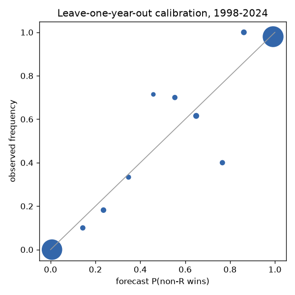

# Model 1 validation

Out-of-sample: every number below comes from a model that never saw the scored year.

| metric | leave-one-year-out (1998-2024) | forward chaining (2018-2024) |
|---|---|---|
| n_races | 473 | 137 |
| n_polled | 390 | 101 |
| n_competitive | 154 | 51 |
| rmse | 9.885 | 6.678 |
| rmse_b2 | 15.22 | 10.74 |
| rmse_polled | 6.142 | 5.29 |
| rmse_b1_polled | 7.252 | 6.418 |
| logloss | 0.1291 | 0.1346 |
| logloss_b2 | 0.2978 | 0.2093 |
| logloss_polled | 0.1363 | 0.174 |
| logloss_b1_polled | 0.1575 | 0.192 |
| brier | 0.04114 | 0.04429 |
| brier_competitive | 0.1254 | 0.119 |
| brier_b1_competitive | 0.146 | 0.1291 |
| brier_b2_competitive | 0.1937 | 0.134 |
| coverage80 | 0.8034 | 0.7591 |
| ece | 0.02215 | 0.03122 |
| max_bin_gap | 0.1782 | 0.02215 |
| accuracy | 0.9387 | 0.927 |

## Gates

| gate | LOYO | forward |
|---|---|---|
| G1 rmse below both baselines | PASS | PASS |
| G2 log loss <= baselines, competitive Brier <= B1 | PASS | PASS |
| G3 80% coverage in [72,88] and bins within 10pp | FAIL | PASS |

## Reliability bins (LOYO)

A bin's gap is only meaningful relative to its sampling error `se` (from the forecast probability).

|   b |   n |     p |     y |    gap |    se |
|----:|----:|------:|------:|-------:|------:|
|   0 | 202 | 0.013 | 0.005 |  0.008 | 0.008 |
|   1 |  20 | 0.286 | 0.25  |  0.036 | 0.101 |
|   2 |  17 | 0.515 | 0.706 | -0.191 | 0.121 |
|   3 |  23 | 0.7   | 0.522 |  0.178 | 0.096 |
|   4 | 211 | 0.984 | 0.981 |  0.003 | 0.009 |

No bin is off by more than two standard errors.

## By cycle (LOYO)

|   cycle |   races |   mean_err |   rmse |   misses |   sigma_nat |    c |
|--------:|--------:|-----------:|-------:|---------:|------------:|-----:|
|    1998 |      34 |       3.77 |  12.16 |        3 |         2.5 | 0.4  |
|    2000 |      33 |      -0.69 |  14.8  |        2 |         2.5 | 0.45 |
|    2002 |      33 |      -5.32 |  14.73 |        3 |         2.5 | 0.35 |
|    2004 |      33 |      -1.26 |  12.56 |        1 |         2.5 | 0.45 |
|    2006 |      32 |      -0.16 |  14.41 |        0 |         2.5 | 0.45 |
|    2008 |      34 |       0.47 |   6.55 |        0 |         2.5 | 0.4  |
|    2010 |      36 |       0.21 |   7.77 |        3 |         2.5 | 0.35 |
|    2012 |      33 |       4.29 |   8.05 |        2 |         2.5 | 0.5  |
|    2014 |      35 |      -3.44 |   5.79 |        1 |         2.5 | 0.45 |
|    2016 |      33 |      -3.65 |   8    |        4 |         2.5 | 0.4  |
|    2018 |      34 |      -1.06 |   4.4  |        4 |         2.5 | 0.45 |
|    2020 |      34 |      -5.72 |   8.85 |        4 |         2.5 | 0.45 |
|    2022 |      34 |      -1.49 |   7.4  |        0 |         2.5 | 0.5  |
|    2024 |      35 |      -3.18 |   4.53 |        2 |         2.5 | 0.45 |

